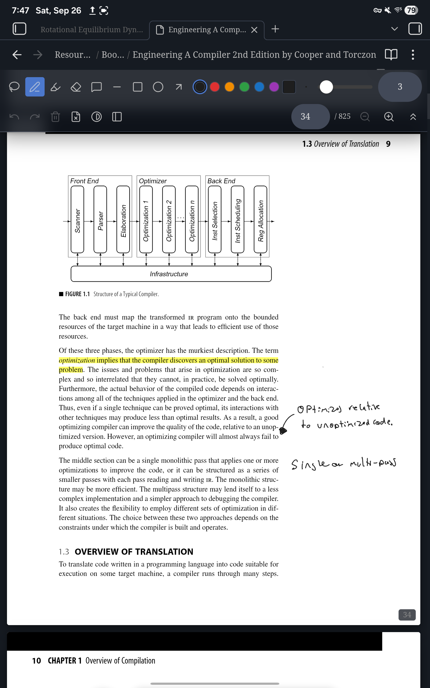

# Inkling

> If you would like to help Inkling by contributing, please fork the repo, or create an issue. For changes created in a fork, if you would like, submit a PR, and we'll get it into an official release on Obsidian! This started as a side project for me, just a guy wanting to only work in his vault. I would love to see the community grow. I had never expected so many people to be interested, but would love to keep development alive. Reach out with changes, and let me know if you want to be added as an official collaborator. - Bluewolf135

## Contributors

- [Bluewolf135](https://github.com/Bluewolf135), who started it
- [user3019](https://github.com/user3019), who forked it as InklingExpanded
  and built a huge amount on top: the customisable toolbar, two pens, the
  text tool, pictures and PDF import, the infinite canvas, page management,
  bookmarks, copy and paste, stylus buttons, editing on two devices at once,
  and backups. All of that is merged in now. More in
  [Credits](#credits-and-license).

---

Inkling lets you write on PDFs and in Markdown notes with a stylus, inside
Obsidian. It was built for a tablet first and a desktop second.

Here's the reason it exists. Xodo and GoodNotes are great PDF annotators,
and if all I wanted was to mark up a PDF I'd use one of them. What I
actually wanted was for a highlight in a textbook to turn into a note I can
search and link, sitting next to everything else I know, without leaving
the app I keep it all in. That's the whole idea: the knowledge stays in the
vault.

<p>
  
  
</p>

**Writing on a textbook page**

https://github.com/user-attachments/assets/f55a433e-ef7c-4e35-8456-6de9dec51359

**Extracting annotations to a note**

https://github.com/user-attachments/assets/40446953-9efd-4fca-be6c-e2305961d351

## Contents

- [What it does](#what-it-does)
- [Pages, pictures and the lasso](#pages-pictures-and-the-lasso)
- [Two devices at once](#two-devices-at-once)
- [How to](#how-to)
- [Keyboard](#keyboard)
- [Installing](#installing)
- [Platforms, mobile and stylus](#platforms-mobile-and-stylus)
- [Privacy](#privacy)
- [Limitations](#limitations)
- [Development](#development)
- [Credits and license](#credits-and-license)

## What it does

> Anything marked † came from [user3019](https://github.com/user3019)'s
> InklingExpanded fork. See [Credits](#credits-and-license).

**Annotate PDFs.** Pen, highlighter, eraser, shapes, text and a lasso, on
any PDF in your vault. The ink gets written into the file as real PDF
annotations, so it shows up in Obsidian's own reader, in Xodo, in Acrobat,
wherever you open it.

**It feels like ink.** Every sample the stylus sends is captured, not just
the one per frame the browser hands out by default. Strokes are fitted to
curves instead of being joined with straight lines, and if your pen reports
pressure, the stroke gets thinner and thicker with it.

**Two pens. †** Tap the pen while it's already selected and you get a
choice: a round pen (smooth, round ends) or a sharp pen (follows your hand
exactly, corners and all). Each one has its own pressure switch and
remembers its own colour and width.

**Type on the page. †** The text tool (`t`) puts a text box where you tap.
Tap anywhere else to finish. Size and colour come from the toolbar.

**More line styles. †** Press a shape tool that's already selected to pick
solid, dashed or dotted, a filled shape, or an arrow with a head on both
ends. These are real PDF annotations too, so other readers show them.

**Highlights become notes.** Drag the highlighter over text and it snaps to
the lines you swept, and remembers the words underneath. Then "Extract
annotations to a note" turns all of that into Markdown, grouped by page.
Each entry links back to `[[book.pdf#page=42]]` and has a block reference,
so you can link to one specific highlight from anywhere.

This works on old highlights too, including ones made in other PDF apps
before you ever installed Inkling. The matching is geometric: if there's a
rectangle over text, Inkling can work out what it covered.

**Comments.** Tap with the note tool, type, and it's saved as a standard
PDF sticky note. Other readers show those as well.

**Handwritten notes.** Make a blank, lined or dot-grid PDF and write
straight into it, adding pages as you go. Or pick **Infinite canvas** †,
which is one sheet that keeps growing in whatever direction you write. It's
still a normal one-page PDF, so it opens anywhere.

**Ink blocks in Markdown.** A ` ```inkling ` block is a drawing area
inside a regular note, for when you want a diagram in the middle of a page
of typing. "Insert ink annotation block" drops a three-line fence into the
note and stores the strokes in an `.ink` file next to your other
attachments, one per note, so the note itself stays small and readable.
Where those files go is a setting.

**Your toolbar, your layout, per device. †** The **Customize toolbar**
button (the sliders icon at the end of the toolbar) opens an editor. Drag
the tools into the order you want, hide the ones you never use, save. Each
device keeps its own layout, so a phone can show six tools while a laptop
shows all of them. The tool you had selected, your colours, widths, pens
and pressure settings all come back the way you left them.

**Getting around.** Outline with editable bookmarks †, page jump, find in
document, a toolbar that collapses out of the way, and a dark mode that
inverts the page without touching the colour of your ink. You can zoom †
the whole document from 25% to 500% (pinch, trackpad pinch, Ctrl+wheel or
the toolbar) and scroll in any direction with a finger, a trackpad or the
middle mouse button. Whatever's on screen gets redrawn at your screen's
resolution, so text, ink, highlights and ink blocks stay sharp however far
in you go.

## Pages, pictures and the lasso

> Everything in this section came from user3019's InklingExpanded fork.

**Change a page's background later, on any PDF.** Switch one page or every
page between blank, lined and dot grid. Whatever's already on the page
stays, with the ruling underneath, and a page that's been turned sideways
gets ruled the way it's shown.

**Add pages to any PDF**, not just notes Inkling made. In a book or a
handout, the new page is blank and the same size as the page you're on.

**Manage pages.** **Manage pages** on the toolbar, or a long press or
right-click on a thumbnail in Obsidian's own PDF reader, opens a list of
every page. Select as many as you like and move them together, turn them,
duplicate, delete or export them. Nothing changes until you press Save.
With a mouse you can also just drag a thumbnail in the reader. Ink, links
and bookmarks stay with their pages, and the page count and thumbnails in
Obsidian's reader update as soon as pages change.

**Export pages.** From the same list: the selected pages as a new PDF, or
as PNG images, saved next to the original with your ink on them.

**Links follow their pages.** `[[Book.pdf#page=12]]` and Markdown links in
your notes get updated when pages move, get added or get deleted, including
a "page 12" written in the link's text. A link to a deleted page is left
alone, and Inkling tells you.

**Bookmarks.** Add, nest, rename and remove them in the outline panel.
They're the PDF's own table of contents, so every other reader shows them.

**Import** the pages of another PDF after the page you're on, or place a
picture from the vault or from your device's file picker, which on a phone
or tablet includes your photos and camera.

**Pictures act like objects.** Move and resize them with the lasso, long
press (pen or finger) to pick one up again, and select them with a finger
on a tablet. A small bar above a selected picture has **copy**, **lock**
(so you can't nudge it by accident), **crop** and **delete**. Crop with the
corner and edge grips. The cropped-off part is actually removed from the
file, and undo brings it back.

**Lasso, copy and paste.** The lasso is drawn like a pen stroke, as a dashed
loop. Whatever it catches gets a thin outline and a frame with handles for
moving and resizing. Copy from the bar above the selection (or Mod+C,
Mod+X). To paste, hold the lasso still on the spot where you want it, pen or
finger, and tap paste, or use Mod+V at the pointer. A copy pastes at the
same size on any page, into another PDF, or into a note's ink block, and
shows up already selected so you can move it.

## Two devices at once

> Everything in this section came from user3019's InklingExpanded fork.

**Live editing.** Open the same PDF on a tablet and a laptop and write on
both. Each one's ink shows up on the other as soon as your sync brings the
file across, merged stroke by stroke.

**Nothing gets saved over another device's save.** Before every save,
Inkling checks whether the file changed, and if it did, takes that change in
first. Pages are matched by identity rather than number, so your ink stays
on its page even if pages were added or deleted on the other device.

**Safe page changes.** Adding, deleting, moving and turning pages,
inserting a PDF and changing backgrounds all pause drawing for a moment,
save anything unsaved first, never overlap with another save, and read the
rebuilt file back before writing it.

**Backups.** Before each of those changes, a copy of the PDF is kept on the
device, the last five per note, in `.obsidian/plugins/inkling/backups/`.
**"Restore an earlier version of this PDF"** brings one back, and keeps the
current state as a backup too, so a restore can't lose anything either.

## How to

| To…                                        | Do this                                                                                                                                               |
| ------------------------------------------ | ----------------------------------------------------------------------------------------------------------------------------------------------------- |
| Rearrange the toolbar                      | Toolbar → **Customize toolbar** (sliders icon) → drag, save.                                                                                          |
| Switch pens                                | Tap the pen while it's already selected.                                                                                                              |
| Create an infinite canvas                  | "Create handwritten note" → paper: **Infinite canvas**.                                                                                               |
| Change a page's background                 | Toolbar → **Page background** → this page or all pages.                                                                                               |
| Arrange pages                              | Toolbar → **Manage pages**, or long-press / right-click a thumbnail → **Manage pages…**. Tap pages to select them, drag by the handle, then **Save**. |
| Turn, duplicate or delete pages            | **Manage pages** → select them → the buttons above the list.                                                                                          |
| Export pages                               | **Manage pages** → select them → **Export** → new PDF or PNG.                                                                                         |
| Add a bookmark                             | Outline panel → **+** next to "Outline" bookmarks the page you're on.                                                                                 |
| Type on a page                             | Text tool (`t`) → tap → type → tap somewhere else.                                                                                                    |
| Dashed lines, filled shapes, double arrows | Press the shape tool that's already selected.                                                                                                         |
| Delete a page                              | In Obsidian's reader, long-press or right-click its thumbnail → **Delete page**.                                                                      |
| Import a PDF or picture                    | Toolbar → **Import**.                                                                                                                                 |
| Pick a picture up again                    | Long-press it with the pen or a finger.                                                                                                               |
| Crop a picture                             | Select it → crop button → drag the grips → ✓.                                                                                                         |
| Copy and paste                             | Lasso → copy → hold the lasso on the target spot → paste.                                                                                             |
| Erase with the side button                 | Hold the button and write. On Android, press it with the pen hovering just above the screen, then touch down.                                         |
| Draw with a finger                         | The finger switch on the toolbar. Two fingers still zoom and pan.                                                                                     |
| Undo a page change                         | Command palette → **Restore an earlier version of this PDF**.                                                                                         |
| See what your pen reports                  | Command palette → **Check stylus input**.                                                                                                             |

## Keyboard

In the annotate view:

| Key                         | Action                                    |
| --------------------------- | ----------------------------------------- |
| `s` `p` `h` `e`             | Select, pen, highlighter, eraser          |
| `l` `r` `o` `a`             | Line, rectangle, oval, arrow              |
| `t`                         | Text                                      |
| `1`–`6`                     | Preset colours                            |
| `[` `]`                     | Thinner, thicker                          |
| `Delete`                    | Delete selection                          |
| `Escape`                    | Drop a selection, a crop or a paste offer |
| `Mod+C` / `Mod+X` / `Mod+V` | Copy, cut, paste                          |
| `Mod+Z` / `Mod+Shift+Z`     | Undo / redo                               |
| `PageUp` / `PageDown`       | Previous / next page                      |
| `Mod+=` / `Mod+-` / `Mod+0` | Zoom in / out / reset                     |

`Mod` is Ctrl on Windows and Linux, Cmd on macOS. Undo and redo are also
commands in the palette, so you can bind them to whatever you want.

## Installing

Inkling is in the community plugin store, but if you're grabbing a pre-release version, install it with
[BRAT](https://github.com/TfTHacker/obsidian42-brat):

1. Install BRAT from Community Plugins.
2. **Add Beta Plugin**, and give it `Bluewolf135/Inkling`.
3. Turn on **Inkling** in Community Plugins.

Or do it by hand: download `main.js`, `manifest.json` and `styles.css` from
a release into `<vault>/.obsidian/plugins/inkling/`.

**Coming over from InklingExpanded?** Everything it added is in Inkling
now. Turn InklingExpanded off before turning Inkling on. They read and
write the same files (your PDFs, `.ink` files and ` ```inkling `
blocks all keep working as they are) and use the same view and block names,
so only one of them can be enabled at a time. Settings and the per-device
toolbar layout are stored under each plugin's own id, so you'll set those
up once more.

## Platforms, mobile and stylus

Windows, macOS, Linux, Android and iOS/iPadOS. Phones, tablets and
computers. Nothing in it is desktop-only. I test on a Samsung tablet with an
S Pen, and user3019 tests on Linux.

- **Palm rejection.** Pen and mouse draw, touch scrolls and pinch-zooms.
  Touch panning is written by hand rather than left to the browser, because
  trusting `touch-action` let a downward pen stroke get hijacked
  mid-stroke on real hardware. There's a toolbar switch † to let a finger
  draw, for phones and for styluses that show up as a finger.
- **Pressure.** Width follows pressure where the stylus reports it, and
  each pen has its own switch for it.
- **Side button and eraser end. †** Hold the side button to erase (or
  highlight, or lasso, it's a setting) and let go to get your tool back. An
  eraser end always erases. Works with Windows and Wacom pens, and on
  Android with the Samsung S Pen and others. The **Check stylus input**
  command shows you exactly what your pen is reporting.
- **Popout windows** work, including shortcuts and dark-mode inversion.
- **Trackpad pinch on Linux** reaches Obsidian under Wayland. Under X11 the
  system doesn't pass it on. Ctrl+wheel zooms either way.
- **Apple Pencil gestures** (double tap, squeeze) aren't available to apps
  running inside Obsidian.

## Privacy

**Inkling makes no network requests.** Everything it reads and writes is a
file in your vault, through Obsidian's own API. No accounts, no telemetry,
nothing sent anywhere.

Obsidian's plugin review flags a few things in the bundle, so here's what
they are:

- **Network calls.** They're in pdf.js, the bundled PDF library. Most
  aren't network code at all: `xref.fetch` looks up an object inside the
  PDF. The real ones download extra fonts, character maps or decoders, and
  pdf.js only makes them when it's given a URL. Inkling hands it the file's
  bytes and never gives it one.
- **Base64 (`atob`/`btoa`).** An ink block's strokes are compressed and
  stored in its `.ink` file as base64 text. That's what these encode and
  decode. Drawing data only. pdf.js also uses them for font data.
- **WebAssembly (`qcms_bg.wasm`, `openjpeg.wasm`).** pdf.js's optional
  colour management and JPEG 2000 modules. Inkling doesn't ship them and
  never tells pdf.js where to find them, so they never load. Without the
  first, pages use the PDF's plain fallback colours instead of embedded
  colour profiles. Without the second, see Limitations.
- **No dynamic code.** The build strips pdf.js's `eval` and `new Function`,
  and fails if either comes back.
- **Clipboard.** "Copy link to page" writes one link to the system
  clipboard. Copying and pasting ink stays inside the plugin.

## Limitations

**Some PDFs open read-only, and that's deliberate.** Inkling rewrites PDFs
with `pdf-lib`, and before it does, it checks the document two ways: it
compares `pdf-lib`'s reading of the file with `pdf.js`'s, and it looks for
interactive forms and digital signatures. If the two readers disagree, or
there's a form or a signature, the PDF still displays with its existing
annotations, but drawing is turned off and a banner says why. Filling in a
form and saving it through here would lose the form, and re-saving a
signed document breaks the signature. Exporting pages from one of those as
a new PDF is refused for the same reason. Exporting them as PNG works.

**Some PDFs get rewritten whole on every save.** Most saves just append
what changed to the end of the file, a kilobyte or two no matter how big the
book, so your sync uploads the change and not the textbook. A file Inkling
can't safely append to gets rewritten in full instead, and for those it
saves less often the bigger the file: every ten seconds under 5 MB, thirty
up to 25 MB, a minute above that. Either way, every save is verified against
the document it came from before a single byte is written.

**The side button on Android.** Android treats a touch with the side button
held as text selection and doesn't pass it to the page. Inkling follows the
pen through that text selection instead, which is why you press the button
with the pen hovering, then touch down. The position comes in small steps,
so erasing with the button is a bit coarser than with the eraser tool.

**Text in other readers.** Typed text looks exactly right in Obsidian.
Other PDF readers draw it in Helvetica, which only covers Western
alphabets.

**Two devices are only as live as your sync.** Devices exchange ink through
the file and nothing else. On Android, Obsidian only notices a file changed
by another app (Syncthing, say) when it looks again. Obsidian Sync doesn't
have to wait.

**Links are updated on the device that made the change**, and restoring an
earlier version of a PDF doesn't change them back.

**Backups stay on the device.** They're skipped for PDFs over 60 MB (books,
whose printed pages a page change never touches), and they go with the
plugin folder if you uninstall the plugin.

**An infinite canvas stops growing at 200 inches a side.** That's the
biggest page other PDF readers will open.

**Extraction is one-way.** Editing an extracted note doesn't change the
PDF.

**JPEG 2000 images don't display.** A few PDFs, mostly scanned books, store
pages or pictures as JPEG 2000. pdf.js decodes those with a WebAssembly
module Inkling doesn't ship, so those images come out blank. The rest of the
page, and any ink on it, is fine.

**Ink blocks only render inside Obsidian**, so a note with one in it is less
portable than a note with an image. Pictures and sticky notes can't be
pasted into an ink block.

**Renaming or moving an `.ink` file breaks its blocks, for now.** The fence
names the file by path and nothing rewrites it yet, so the blocks show a
read-only "missing" banner and never save over anything. Move the file back
and they come back. Renaming or moving the _note_ is fine. Blocks made by
older versions, with their strokes inside the note, keep working exactly as
before.

## Development

```bash
npm install
npm run dev     # watch build
npm test        # vitest
npm run lint
npm run build   # type-check and production bundle
```

`pdf-lib` and `pdfjs-dist` are pinned to exact versions, for reasons
written up at the top of `src/pdfView.ts`. Please read that before bumping
either of them.

Design docs and implementation plans live in `docs/superpowers/`. Branches,
commit messages and releases are described in
[CONTRIBUTING.md](CONTRIBUTING.md).

## Credits and license

Inkling was written by [Bluewolf135](https://github.com/Bluewolf135)
(William DeStefano).

A big part of what's described above started life as
[InklingExpanded](https://github.com/user3019/InklingExpanded), a fork by
[user3019](https://github.com/user3019). They reached out, we talked, and
their work is merged back into Inkling with every commit under their name.
Theirs is: the per-device toolbar editor and remembered tool settings; the
round and sharp pens; the text tool, dashed and dotted lines, filled shapes
and double-headed arrows; pictures and PDF import, cropping, and copy and
paste with the lasso; the infinite canvas and reader-style zoom while
editing; page backgrounds after the fact, adding pages to any PDF, the
Manage pages dialog, page export, bookmarks, and links that follow their
pages; the stylus side button and eraser end, finger drawing and the stylus
check; editing on two devices at once, pages matched by identity, and
backups before every page change; plus a long list of fixes along the way.
Thank you user3019 for all your contributions to the project!

MIT. See [LICENSE](LICENSE).
