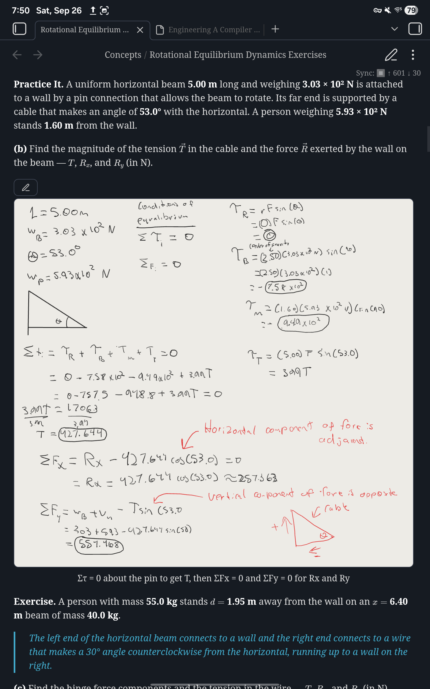

# Inkling

> If you would like to help Inkling by contributing, please fork the repo, or create an issue. For changes created in a fork, if you would like, submit a PR, and we'll get it into an official release on Obsidian! This started as a side project for me, just a guy wanting to only work in his vault. I would love to see the community grow. I had never expected so many people to be interested, but would love to keep development alive. Reach out with changes, and let me know if you want to be added as an official collaborator. - Bluewolf135

## Contributors

- [Bluewolf135](https://github.com/Bluewolf135) — original author
- [user3019](https://github.com/user3019) — the InklingExpanded fork, merged
  into Inkling: customisable toolbar, two pens, text tool, pictures and PDF
  import, infinite canvas, page management, bookmarks, copy and paste, stylus
  buttons, live editing on two devices, and backups. See
  [Credits](#credits-and-license).

---

Handwritten and text annotation for PDFs and Markdown notes in Obsidian,
built mobile-first for stylus input.

Inkling exists for one reason: **the knowledge stays in the vault.** Xodo
and GoodNotes are excellent PDF annotators, and if annotating the PDF were
the point you should use one of them. The point is that a highlight in a
textbook becomes a searchable, linkable Markdown note sitting beside
everything else you know — without leaving the app you keep it all in.

<p>
  
  
</p>

**Writing on a textbook page**

https://github.com/user-attachments/assets/f55a433e-ef7c-4e35-8456-6de9dec51359

**Extracting annotations to a note**

https://github.com/user-attachments/assets/40446953-9efd-4fca-be6c-e2305961d351

## Contents

- [What it does](#what-it-does)
- [Pages, pictures and the lasso](#pages-pictures-and-the-lasso)
- [Two devices at once](#two-devices-at-once)
- [How to](#how-to)
- [Keyboard](#keyboard)
- [Installing](#installing)
- [Platforms, mobile and stylus](#platforms-mobile-and-stylus)
- [Privacy](#privacy)
- [Limitations](#limitations)
- [Development](#development)
- [Credits and license](#credits-and-license)

## What it does

> Features marked † came from [user3019](https://github.com/user3019)'s
> InklingExpanded fork, merged into Inkling. See
> [Credits](#credits-and-license).

**Annotate PDFs.** Pen, highlighter, eraser, shapes, text and lasso
selection, over any PDF in your vault. Ink is written into the file as real
PDF annotations, so it shows up in Obsidian's own reader, in Xodo, in
Acrobat — anywhere.

**Feels like ink.** Every stylus sample is captured, not just the one per
frame the browser volunteers; strokes are curve-fitted rather than joined
with straight lines; and a pen that reports pressure draws a stroke that
tapers with it.

**Two pens. †** Tap the pen while it is in hand to choose between a **round
pen** (smooth, round ends) and a **sharp pen** (follows your hand exactly,
corners and all). Each has its own pressure switch and remembers its own
colour and width.

**Type on the page. †** The text tool (`t`) puts a box where you tap; a tap
anywhere else finishes it. Size and colour follow the toolbar.

**More line styles. †** Press a shape tool that is already in hand to choose
solid, dashed or dotted, a filled shape, or an arrow with a head at both
ends. They are real PDF annotations, so other readers show them too.

**Highlights become notes.** Drag the highlighter over text and it snaps to
the lines it swept — and remembers the words it covered. "Extract
annotations to a note" turns those into Markdown, grouped by page, each
entry linking back to `[[book.pdf#page=42]]` and carrying a block reference
so you can link to one specific highlight.

That works retroactively, on highlights made before you installed this and
on highlights made in other PDF software: the match is geometric, so
anything with a rectangle over text can have its quote recomputed.

**Comments.** Tap with the note tool, type, and it commits as a standard
PDF sticky note — which means other readers show it too.

**Handwritten notes.** Create a blank, lined, or dot-grid PDF and write
straight into it, adding pages as you fill them. Or choose **Infinite
canvas** †: one sheet that grows smoothly in whichever direction you write,
still an ordinary one-page PDF that opens anywhere.

**Ink blocks in Markdown.** A ```` ```inkling ```` block is a drawing
surface inside an ordinary note, for a diagram in the middle of a page of
typing. "Insert ink annotation block" leaves a three-line fence in the note
and keeps the strokes in an `.ink` file beside your other attachments, one
per note, so the note stays readable and small. Where those files go is a
setting.

**Your toolbar, per device. †** The **Customize toolbar** button (sliders
icon) at the end of the toolbar opens an editor: drag the tools into the
order you want, hide the ones you never use, save. Each device keeps its own
layout — a phone can show six tools, a laptop all of them — and the tool in
hand, colours, widths, pens and pressure come back as you left them.

**Getting around.** Outline with editable bookmarks †, page jump,
find-in-document, a collapsible toolbar, and dark-mode page inversion that
darkens the page without touching the colour of your ink. Zoom † the whole
document from 25% to 500% — pinch, trackpad pinch, Ctrl+wheel or the
toolbar — and scroll in every direction with a finger, the trackpad or the
middle mouse button. The part of the page on screen is redrawn at the
screen's resolution, so text, ink, highlights and ink blocks stay sharp at
any zoom.

## Pages, pictures and the lasso

> Everything in this section came from user3019's InklingExpanded fork.

**Page background, after the fact, in any PDF.** Switch any page — or every
page — between blank, lined and dot grid. Pages with content keep it, with
the ruling underneath, and a page turned sideways is ruled the way it is
shown.

**Add pages to any PDF**, not only notes made by the plugin. In a book or a
handout the new page is blank and the size of the page you are on.

**Manage pages.** The toolbar's **Manage pages**, or a long press or
right-click on a thumbnail in Obsidian's own PDF reader, opens a list of
every page. Select any number and move them together, turn, duplicate,
delete or export them; nothing changes until you press Save. With a mouse
you can also drag a thumbnail straight in the reader. Ink, links and
bookmarks stay with their pages, and page counts and thumbnails in
Obsidian's reader update as soon as pages change.

**Export pages.** From the same list: selected pages as a new PDF, or as
PNG pictures, next to the original and with your ink on them.

**Links follow their pages.** `[[Book.pdf#page=12]]` and Markdown links in
your notes are updated when pages move, are added or are deleted, including
a "page 12" in the link's text. A link to a deleted page is left as it was,
and you are told.

**Bookmarks.** Add, nest, rename and remove them in the outline panel. They
are the PDF's own table of contents, so every other reader shows them.

**Import** the pages of another PDF after the page you are on, or place a
picture — from the vault, or from the device's file picker, photos and
camera.

**Pictures behave like objects.** Move and resize them with the lasso; long
press (pen or finger) to pick one up again; select them with a finger on a
tablet. A small bar above a selected picture has **copy**, **lock** (locked
pictures cannot be moved by accident), **crop** and **delete**. Crop with
corner and edge grips: the cropped-away part is really removed from the
file, and undo brings it back.

**Lasso, copy and paste.** The lasso is drawn like a pen stroke as a dashed
loop; what it catches gets a thin outline and a frame with handles to move
and resize it. Copy from the bar above a selection (or Mod+C, Mod+X). Hold
the lasso still on the spot it should go — pen or finger — and tap paste
(or Mod+V at the pointer). A copy pastes at the same size on any page, into
another PDF or into a note's ink block, and arrives selected, ready to
move.

## Two devices at once

> Everything in this section came from user3019's InklingExpanded fork.

**Live editing.** Open the same PDF on a tablet and a laptop and write on
both: each one's ink appears on the other as soon as your sync brings the
file over, merged stroke by stroke.

**Nothing is saved over another device's save.** Before every save the file
is checked; a change from elsewhere is taken in first. Pages are matched by
identity, so ink stays on its page even when pages were added or deleted on
the other device.

**Safe page changes.** Adding, deleting, moving and turning pages, inserting
a PDF and changing backgrounds pause drawing for a moment, save what is
unsaved first, never overlap with another save, and read the rebuilt file
back before it is written.

**Backups.** A copy of the PDF is kept on the device before each of those
changes, the last five per note, in
`.obsidian/plugins/inkling/backups/`. **"Restore an earlier version of this
PDF"** brings one back, and keeps the current state as a backup too.

## How to

| To… | Do this |
|---|---|
| Rearrange the toolbar | Toolbar → **Customize toolbar** (sliders icon) → drag, save. |
| Switch pens | Tap the pen while it is already in hand. |
| Create an infinite canvas | "Create handwritten note" → paper: **Infinite canvas**. |
| Change a page's background | Toolbar → **Page background** → this page or all pages. |
| Arrange pages | Toolbar → **Manage pages**, or long-press / right-click a thumbnail → **Manage pages…**. Tap pages to select them, drag by the handle, then **Save**. |
| Turn, duplicate or delete pages | **Manage pages** → select them → the buttons above the list. |
| Export pages | **Manage pages** → select them → **Export** → new PDF or PNG. |
| Add a bookmark | Outline panel → **+** next to "Outline" bookmarks the page you are on. |
| Type on a page | Text tool (`t`) → tap → type → tap elsewhere. |
| Dashed lines, filled shapes, double arrows | Press the shape tool in hand again. |
| Delete a page | In Obsidian's reader, long-press or right-click its thumbnail → **Delete page**. |
| Import a PDF or picture | Toolbar → **Import**. |
| Pick a picture up again | Long-press it with the pen or a finger. |
| Crop a picture | Select it → crop button → drag the grips → ✓. |
| Copy and paste | Lasso → copy → hold the lasso on the target spot → paste. |
| Erase with the side button | Hold the button and write. On Android, press it with the pen just above the screen, then touch down. |
| Draw with a finger | The finger switch on the toolbar. Two fingers still zoom and pan. |
| Undo a page change | Command palette → **Restore an earlier version of this PDF**. |
| See what your pen reports | Command palette → **Check stylus input**. |

## Keyboard

Inside the annotate view:

| Key | Action |
|---|---|
| `s` `p` `h` `e` | Select, pen, highlighter, eraser |
| `l` `r` `o` `a` | Line, rectangle, oval, arrow |
| `t` | Text |
| `1`–`6` | Preset colours |
| `[` `]` | Thinner, thicker |
| `Delete` | Delete selection |
| `Escape` | Let go of a selection, a crop or a paste offer |
| `Mod+C` / `Mod+X` / `Mod+V` | Copy, cut, paste |
| `Mod+Z` / `Mod+Shift+Z` | Undo / redo |
| `PageUp` / `PageDown` | Previous / next page |
| `Mod+=` / `Mod+-` / `Mod+0` | Zoom in / out / reset |

`Mod` is Ctrl on Windows and Linux, Cmd on macOS. Undo and redo are also
palette commands, so you can bind them globally.

## Installing

Not in the community catalogue yet. Install with
[BRAT](https://github.com/TfTHacker/obsidian42-brat):

1. Install BRAT from Community Plugins.
2. **Add Beta Plugin**, and give it `Bluewolf135/Inkling`.
3. Enable **Inkling** in Community Plugins.

Or manually: download `main.js`, `manifest.json` and `styles.css` from a
release into `<vault>/.obsidian/plugins/inkling/`.

**Coming from InklingExpanded?** Everything it added is in Inkling now.
Turn InklingExpanded off before enabling Inkling: both read and write the
same files — your PDFs, `.ink` files and ```` ```inkling ```` blocks keep
working unchanged — and use the same view and block names, so only one may
be enabled at a time. Settings and the per-device toolbar layout are kept
under each plugin's own id, so set those up once more.

## Platforms, mobile and stylus

Windows, macOS, Linux, Android and iOS/iPadOS — phones, tablets and
computers. No desktop-only APIs are used. Built mobile-first, and tested on
a Samsung tablet with an S Pen and on Linux.

- **Palm rejection.** Pen and mouse draw; touch scrolls and pinch-zooms.
  Touch panning is hand-rolled rather than left to the browser, because
  relying on `touch-action` let a downward pen stroke get taken over
  mid-draw on real hardware. A toolbar switch † lets a finger draw, for
  phones and for styluses that report themselves as a finger.
- **Pressure.** Pressure varies stroke width where the stylus reports it,
  and each pen has its own switch for it.
- **Side button and eraser end** †. Hold the side button to erase (or
  highlight, or lasso — a setting) and let go to get your tool back; an
  eraser end always erases. Works with Windows and Wacom pens, and on
  Android with the Samsung S Pen and other pens. The **Check stylus input**
  command shows exactly what your pen reports.
- **Popout windows** work, shortcuts and dark-mode inversion included.
- **Trackpad pinch on Linux** reaches Obsidian under Wayland; under X11 the
  system does not pass it on. Ctrl+wheel zooms either way.
- **Apple Pencil gestures** (double tap, squeeze) are not available to apps
  running inside Obsidian.

## Privacy

**Inkling makes no network requests.** Everything it reads and writes is a
file in your vault, through Obsidian's own API. No accounts, no telemetry,
nothing sent anywhere.

Obsidian's plugin review lists a few things in the bundle worth explaining:

- **Network calls.** They are in the bundled PDF library, pdf.js. Most are
  not network code at all: `xref.fetch` looks up an object inside the PDF.
  The real ones download extra fonts, character maps or decoders, and pdf.js
  makes them only when given a URL to fetch from. Inkling hands it the
  file's bytes and never sets one.
- **Base64 (`atob`/`btoa`).** An ink block's strokes are compressed and
  stored in its `.ink` file as base64 text, which these encode and decode.
  They carry drawing data only. pdf.js also uses them for font data.
- **WebAssembly (`qcms_bg.wasm`, `openjpeg.wasm`).** pdf.js's optional
  colour-management and JPEG 2000 modules. Inkling does not ship them and
  never tells pdf.js where to find them, so they are never loaded. Without
  the first, pages use the PDF's plain fallback colours instead of its
  embedded colour profiles. Without the second, see Limitations.
- **No dynamic code.** The build removes pdf.js's `eval` and
  `new Function`, and fails if any come back.
- **Clipboard.** "Copy link to page" writes one link to the system
  clipboard. Copy and paste of ink stays inside the plugin.

## Limitations

**Some PDFs open read-only, on purpose.** Inkling rewrites a PDF through
`pdf-lib`, and before it will do that it checks the document two ways: it
compares `pdf-lib`'s reading of the file against `pdf.js`'s, and it looks
for interactive forms and digital signatures. If the two readers disagree,
or the document has a form or a signature, the book renders and its
existing annotations display but drawing is turned off, with a banner
saying why. Filling in a form and saving it through here would lose the
form; re-serializing a signed document invalidates the signature. Exporting
such a PDF's pages as a new PDF is refused for the same reason; exporting
them as PNG works.

**Some PDFs are rewritten whole on every save.** Most saves append only
what changed to the end of the file — a kilobyte or two, however large the
book — so sync uploads the change rather than the textbook. A file whose
structure Inkling cannot safely append to is rewritten whole instead, and
for those it scales how often it saves to the file's size: ten seconds
under 5 MB, thirty up to 25 MB, a minute above. Either way, every save is
verified against the document it came from before a byte is written.

**The side button on Android.** Android keeps a touch made with the side
button held for selecting text and does not pass it to the page. Inkling
follows the pen through that text selection instead, so press the button
with the pen just above the screen, then touch down. The position comes in
small steps, so erasing with the button is a little coarser than with the
eraser tool.

**Text in other readers.** Typed text shows exactly in Obsidian everywhere;
other PDF readers draw it in Helvetica, which covers Western alphabets
only.

**Live only as fast as your sync.** Two devices exchange ink through the
file and nothing else. On Android, Obsidian notices a file changed by
another app (Syncthing, say) only when it looks again; Obsidian Sync does
not have to wait.

**Links are followed in Markdown notes** on the device that made the
change, and restoring an earlier version of a PDF does not change them
back.

**Backups stay on the device**, are skipped for PDFs over 60 MB (books,
whose printed pages a page change never touches), and go with the plugin
folder if the plugin is uninstalled.

**An infinite canvas stops growing at 200 inches a side**, the largest page
other PDF readers open.

**Extraction is one-directional.** Editing an extracted note does not
change the PDF.

**JPEG 2000 images do not display.** A few PDFs, mostly scanned books,
store pages or pictures as JPEG 2000. pdf.js decodes those with a
WebAssembly module Inkling does not ship, so those images are left blank.
The rest of the page, and any ink on it, is unaffected.

**Ink blocks render only inside Obsidian**, so a note holding one is less
portable than one holding an image. Pictures and sticky notes cannot be
pasted into an ink block.

**Renaming or moving an `.ink` file breaks its blocks, for now.** The fence
names the file by path, and nothing rewrites it yet, so the blocks show a
read-only "missing" banner and never save over anything. Move the file
back and they return. Renaming or moving the *note* is fine. Blocks made
by earlier versions, with their strokes inside the note, keep working
exactly as they did.

## Development

```bash
npm install
npm run dev     # watch build
npm test        # vitest
npm run lint
npm run build   # type-check and production bundle
```

`pdf-lib` and `pdfjs-dist` are pinned to exact versions for reasons
recorded at the top of `src/pdfView.ts`. Don't bump them without reading
that comment.

Design documents and implementation plans live in `docs/superpowers/`.
Branches, commit messages and releases are described in
[CONTRIBUTING.md](CONTRIBUTING.md).

## Credits and license

Inkling was written by [Bluewolf135](https://github.com/Bluewolf135)
(William DeStefano).

Much of what is described above arrived as
[InklingExpanded](https://github.com/user3019/InklingExpanded), a fork by
[user3019](https://github.com/user3019), merged back into Inkling with
every commit under their name. Theirs is the work on: the per-device
toolbar editor and remembered tool settings; the round and sharp pens; the
text tool, dashed and dotted lines, filled shapes and double-headed arrows;
pictures and PDF import, cropping, and the lasso's copy and paste; the
infinite canvas and reader-style zoom while editing; page backgrounds after
the fact, adding pages to any PDF, the Manage pages dialog, page export,
bookmarks, and links that follow their pages; the stylus side button and
eraser end, finger drawing and the stylus check; live editing on two
devices, pages matched by identity, and backups before every page change;
and a long list of fixes along the way. Thank you.

MIT — see [LICENSE](LICENSE).
